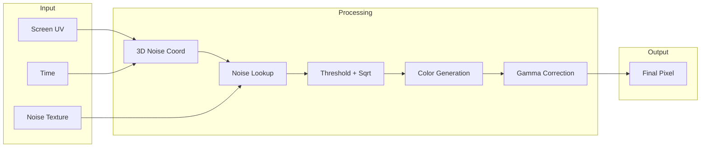
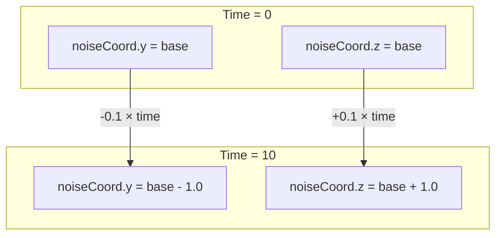
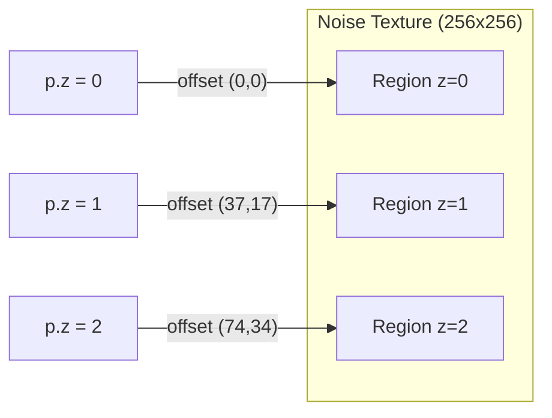
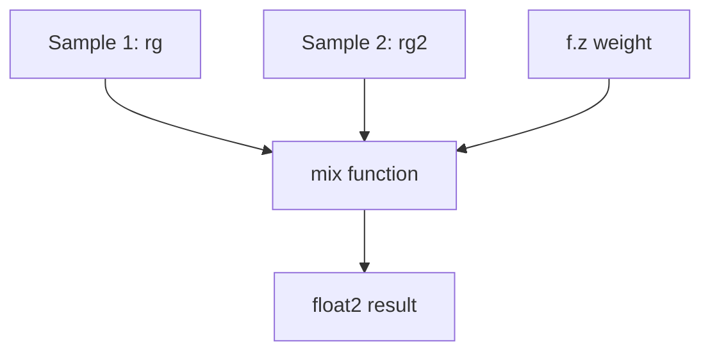
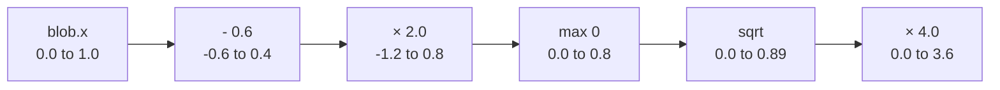
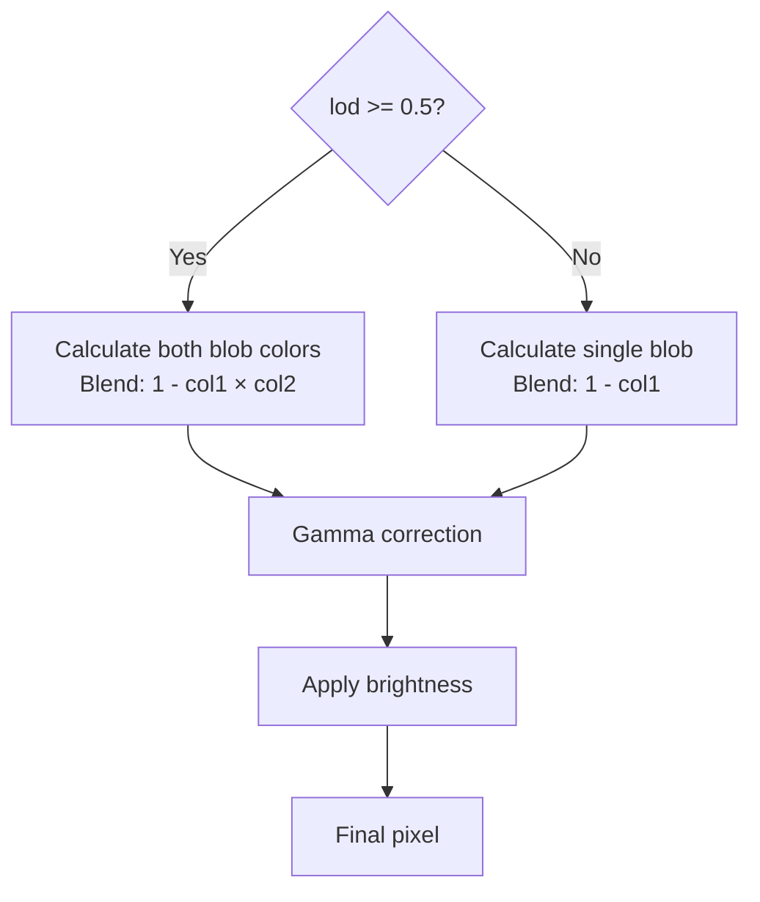

# LavaLite Metal Shader

A fragment shader that creates an animated lava lamp effect with flowing colored blobs. Originally translated from a Shadertoy shader by Hazel Quantock (2013).

## Table of Contents

1. [Overview](#overview)
2. [Input Structures](#input-structures)
3. [UV Coordinate Setup](#uv-coordinate-setup)
4. [3D Noise Coordinate Construction](#3d-noise-coordinate-construction)
5. [The Noise Function](#the-noise-function)
6. [Blob Color Generation](#blob-color-generation)
7. [Color Blending and LOD](#color-blending-and-lod)
8. [Performance Optimizations](#performance-optimizations)

---

## Overview

The shader transforms screen coordinates into animated, organic blob shapes by sampling a noise texture in 3D space. Time-based offsets create the characteristic rising motion of a lava lamp.



---

## Input Structures

```metal
struct Uniforms {
    float2 resolution;   // Screen dimensions (e.g., 390x844)
    float time;          // Continuously increasing animation time
    float lod;           // Level of detail: 0.0 (low) to 1.0 (high)
};

struct Parameters {
    float brightness;    // User-controlled brightness multiplier
};
```

| Field | Purpose |
|-------|---------|
| `resolution` | Used for aspect ratio correction |
| `time` | Drives the animation; increments each frame |
| `lod` | Enables quality scaling for battery savings |
| `brightness` | Allows users to dim the background |

---

## UV Coordinate Setup

**Line 61:**
```metal
float2 uv = (in.uv - 0.5f) * float2(1.0f, u.resolution.y / u.resolution.x);
```

$$
\text{uv} = (\text{uv}_{in} - 0.5) \times \begin{pmatrix} 1 \\ \frac{\text{height}}{\text{width}} \end{pmatrix}
$$

This transformation:
1. **Centers** the coordinate system at (0, 0) instead of (0.5, 0.5)
2. **Corrects aspect ratio** so blobs appear circular, not stretched

```
BEFORE (texture coords)          AFTER (centered, aspect-corrected)

(0,0)─────────(1,0)              (-0.5,+0.9)───(+0.5,+0.9)
  │             │                      │             │
  │   (0.5,0.5) │         ──►          │    (0,0)    │
  │      ·      │                      │      ·      │
  │             │                      │             │
(0,1)─────────(1,1)              (-0.5,-0.9)───(+0.5,-0.9)
```

---

## 3D Noise Coordinate Construction

**Lines 64-65:**
```metal
float3 noiseCoord = float3(uv.x, uv.y * SQRT3_HALF, uv.y * 0.5f) * 4.0f;
noiseCoord.yz += u.time * float2(-0.1f, 0.1f);
```

### Coordinate Transformation

The 2D screen position maps to a 3D noise space:

$$
\text{noiseCoord} = 4 \cdot \begin{pmatrix} u \\ v \cdot \frac{\sqrt{3}}{2} \\ v \cdot 0.5 \end{pmatrix}
$$

| Component | Formula | Purpose |
|-----------|---------|---------|
| `x` | `uv.x` | Horizontal position (unchanged) |
| `y` | `uv.y * 0.866` | Compressed vertical axis |
| `z` | `uv.y * 0.5` | Depth derived from vertical position |

The $\frac{\sqrt{3}}{2} \approx 0.866$ factor creates a hexagonal-style coordinate system that produces more organic-looking noise patterns.

### Scale Factor

The `* 4.0f` multiplier controls blob density:

| Scale | Result |
|-------|--------|
| 1.0 | Few large blobs |
| 4.0 | Medium blobs (default) |
| 8.0 | Many small blobs |

### Time-Based Animation

After the initial transformation, time offsets are applied:

$$
\begin{aligned}
\text{noiseCoord}.y &\mathrel{+}= -0.1 \cdot t \\
\text{noiseCoord}.z &\mathrel{+}= +0.1 \cdot t
\end{aligned}
$$



The y-component decreases while z increases, creating a swirling upward motion rather than simple translation.

---

## The Noise Function

**Lines 39-51:**
```metal
static inline float2 Noise(float3 x, texture2d<float> noiseTex, sampler s) {
    float3 p = floor(x);
    float3 f = x - p;
    f = f * f * (3.0f - 2.0f * f);  // Smoothstep

    float2 uv = p.xy + NOISE_OFFSET * p.z + f.xy;

    float4 rg = noiseTex.sample(s, (uv + 0.5f) * INV_256);
    float4 rg2 = noiseTex.sample(s, (uv + NOISE_OFFSET2) * INV_256);

    return mix(rg2.xz, rg.xz, f.z);
}
```

This function generates 3D Perlin-style noise from a 2D texture.

### Step 1: Grid Decomposition

For input `x = (2.7, 3.4, 1.2)`:

| Variable | Value | Meaning |
|----------|-------|---------|
| `p` | `(2, 3, 1)` | Grid cell coordinates |
| `f` | `(0.7, 0.4, 0.2)` | Position within cell |

### Step 2: Smoothstep Interpolation

The smoothstep formula creates smooth transitions between grid cells:

$$
S(x) = x^2(3 - 2x) = 3x^2 - 2x^3
$$

This is a cubic Hermite interpolation with zero derivatives at $x = 0$ and $x = 1$:

```
Linear interpolation:        Smoothstep interpolation:

1.0 ┐      /                 1.0 ┐       ___---
    │     /                      │    __/
    │    /                       │   /
    │   /                        │  /
0.0 ┴──/────                 0.0 ┴─/────────
    0     1                      0        1

Sharp transitions            Smooth ease-in-out
```

### Step 3: Faking 3D with 2D Texture

The key insight: different z-values sample from different regions of the same 2D texture.



The offset `NOISE_OFFSET = (37, 17)` ensures each z-layer samples unrelated noise values.

### Step 4: Z-Axis Interpolation

Two texture samples are blended based on `f.z` using linear interpolation:

$$
\text{result} = \text{mix}(a, b, t) = a \cdot (1 - t) + b \cdot t
$$



| $f_z$ Value | Result |
|-------------|--------|
| 0.0 | 100% from `rg2` |
| 0.5 | 50% blend |
| 1.0 | 100% from `rg` |

The function returns two independent noise channels (from red and blue texture channels).

---

## Blob Color Generation

**Lines 69-76:**
```metal
const float3 ink1 = float3(0.1f, 0.9f, 0.8f);  // Cyan-teal
const float3 ink2 = float3(0.9f, 0.1f, 0.6f);  // Magenta-pink

float exp1 = 4.0f * fast::sqrt(max(0.0f, (blob.x - 0.6f) * 2.0f));
float3 col1 = powr(ink1, float3(exp1));
```

### Ink Colors

| Ink | RGB | Appearance |
|-----|-----|------------|
| `ink1` | (0.1, 0.9, 0.8) | Cyan / Teal |
| `ink2` | (0.9, 0.1, 0.6) | Magenta / Pink |

### Thresholding Pipeline



Only noise values above 0.6 produce visible blobs. Values below this threshold are clamped to zero.

The complete exponent formula:

$$
e = 4 \cdot \sqrt{\max(0, \; 2(n - 0.6))}
$$

where $n$ is the noise value (0.0 to 1.0).

### Soft Edges via Square Root

The `sqrt` function creates soft, glowing blob edges:

```
Without sqrt (linear):       With sqrt (soft falloff):

1.0 ┐        ___             1.0 ┐     ___---────
    │    ___/                    │   _/
    │   /                        │  /
    │  /                         │ /
0.0 ┴─/──────                0.0 ┴/───────────
   0.6    1.0                   0.6        1.0
```

### Color via Exponentiation

The `powr(ink, exponent)` function raises each color channel to a power:

$$
\text{color} = \text{ink}^e = (r^e, \; g^e, \; b^e)
$$

| Exponent | Result | Location |
|----------|--------|----------|
| 0.0 | White (1, 1, 1) | Blob edge |
| 1.0 | Full ink color | Mid-blob |
| 4.0 | Darkened ink | Blob center |

---

## Color Blending and LOD

**Lines 78-91:**
```metal
if (u.lod >= 0.5f) {
    // Full quality
    float exp2 = 4.0f * fast::sqrt(max(0.0f, (blob.y - 0.6f) * 2.0f));
    float3 col2 = powr(ink2, float3(exp2));
    color = powr(1.0f - col1 * col2, float3(INV_GAMMA));
} else {
    // Low quality
    color = powr(1.0f - col1, float3(INV_GAMMA));
}

color *= p.brightness;
```

### LOD Branching



### Two-Layer Color Blending

When both colors are calculated, the final color formula is:

$$
\text{color} = \left(1 - \text{col}_1 \times \text{col}_2\right)^{1/\gamma}
$$

Visually:

```
col1 × col2 multiplication:

╭───────╮                    ╭───────╮
│ CYAN  │                    │MAGENTA│
│ BLOB  │                    │ BLOB  │
╰───┬───╯                    ╰───┬───╯
    │                            │
    └──────────┬─────────────────┘
               ▼
        1.0 - (col1 × col2)
               │
    ┌──────────┴──────────┐
    ▼                     ▼
Overlap regions:      No-blob regions:
Bright mixed color    Dark background
```

### Gamma Correction

Gamma correction converts from linear light to sRGB color space:

$$
\text{color}_{sRGB} = \text{color}_{linear}^{1/\gamma} = \text{color}_{linear}^{1/2.2} \approx \text{color}_{linear}^{0.4545}
$$

This ensures correct display on screens, which expect gamma-encoded values.

---

## Performance Optimizations

| Technique | Location | Benefit |
|-----------|----------|---------|
| `fast::sqrt` | Lines 75, 81 | Hardware-accelerated approximation |
| `powr` | Lines 76, 82, 83, 86 | Optimized for positive bases |
| LOD branching | Line 79 | Skips second blob on low-quality mode |
| Precomputed constants | Lines 32-36 | Avoids runtime division |
| `static inline` | Line 39 | Encourages function inlining |

---

## Animation Summary

The shader creates the lava lamp effect through:

1. **Noise sampling** in 3D space creates organic blob shapes
2. **Time offsets** shift the noise coordinates, making blobs appear to rise
3. **Thresholding** turns continuous noise into distinct blob shapes
4. **Dual colors** (cyan and magenta) blend where blobs overlap
5. **Soft edges** via square root create a glowing, fluid appearance
